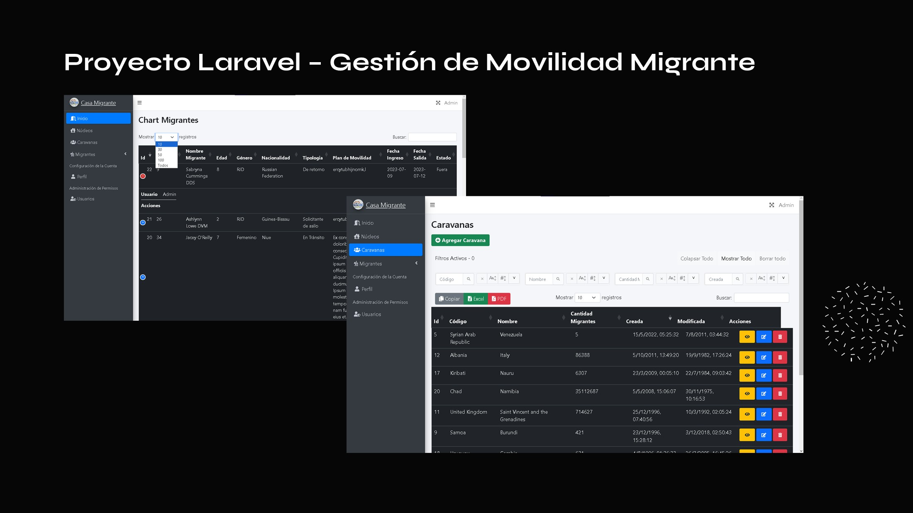
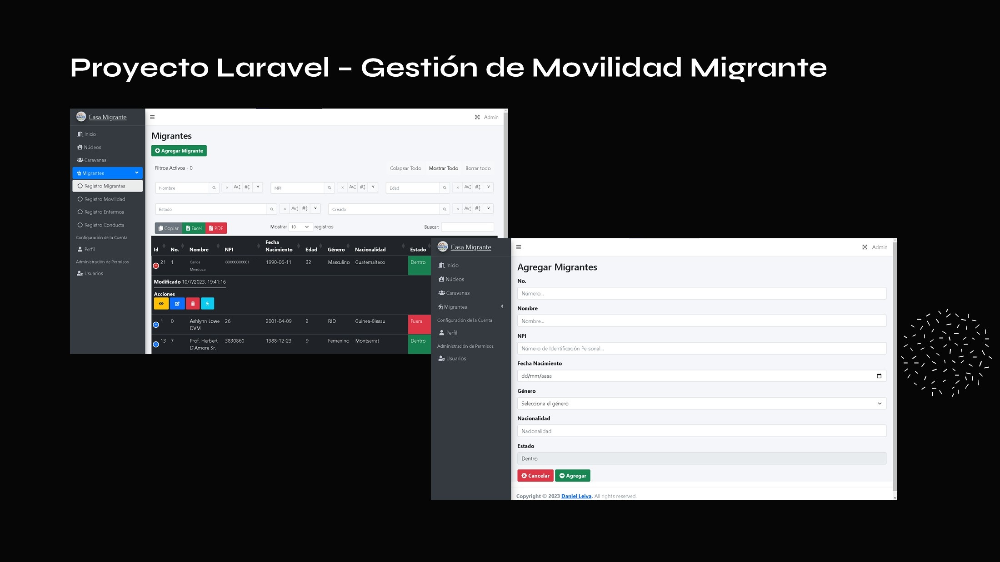
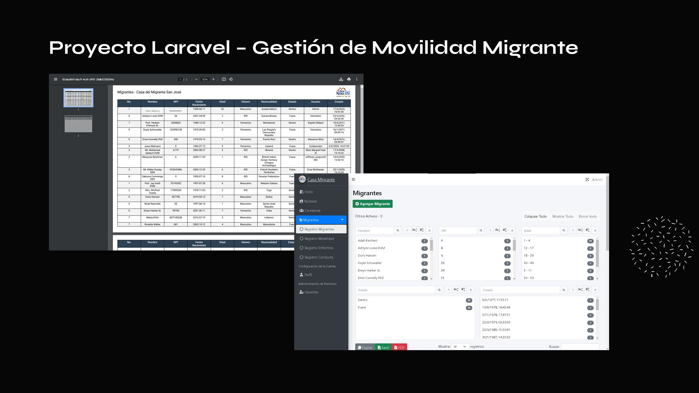
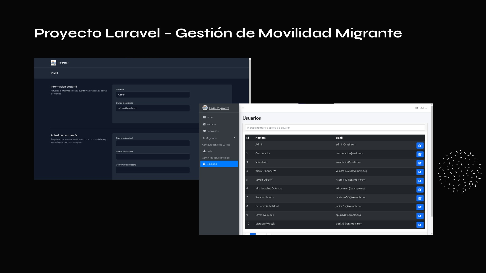

# Sistema de Gestión de Movilidad Migrante — Laravel

Aplicación web desarrollada con **Laravel 10**, **Jetstream**, **Livewire** y **AdminLTE 3** para la gestión integral de registros en **Casa del Migrante San José**, incluyendo migrantes, núcleos familiares, caravanas, movilidad, salud, conducta y control de usuarios por roles.

## Vista previa

| Gráficos y Caravanas | Listado y registro de Migrantes |
| :---: | :---: |
|  |  |

| Exportación PDF y filtros DataTables | Perfil y gestión de Usuarios |
| :---: | :---: |
|  |  |

## Características principales

- **Gestión de Migrantes, Núcleos y Caravanas:** Módulos CRUD completos con filtros avanzados mediante **Yajra DataTables** y exportación a **Excel** y **PDF**.
- **Registros de seguimiento:** Control de registros de movilidad, salud (*Registro Enfermos*) y conducta, con gráficas estadísticas en el panel inicial.
- **Autenticación y permisos:** Inicio de sesión y gestión de perfil con **Laravel Jetstream / Fortify** y control de acceso por roles (`Admin`, `Colaborador`, `Voluntario`) con **Spatie Laravel Permission**.
- **Administración de usuarios:** Listado y asignación de roles mediante componentes **Livewire**.

## Tecnologías utilizadas

- **PHP 8.1+** y **Laravel 10**
- **Laravel Jetstream**, **Sanctum** y **Livewire 2**
- **AdminLTE 3** (`jeroennoten/laravel-adminlte`), **Bootstrap 5** y **Tailwind CSS**
- **Spatie Laravel Permission**, **Yajra DataTables**, **Laravel Charts** y **DataTables / pdfmake**
- **MySQL** (configurable mediante `.env`), **Vite** y **Faker** (factories y seeders de prueba)

## Contexto y estado del proyecto

- **Contexto:** Proyecto académico de certificación de **INTECAP** desarrollado en 2023 que conserva su implementación original con fines demostrativos. **No está preparado para entornos de producción.**
- **Estado:** Finalizado (archivado para portafolio). La configuración sensible (`APP_KEY`, credenciales de base de datos) se gestiona mediante `.env` a partir de `.env.example`.

## Autor

**Daniel Alejandro Arita Leiva**
